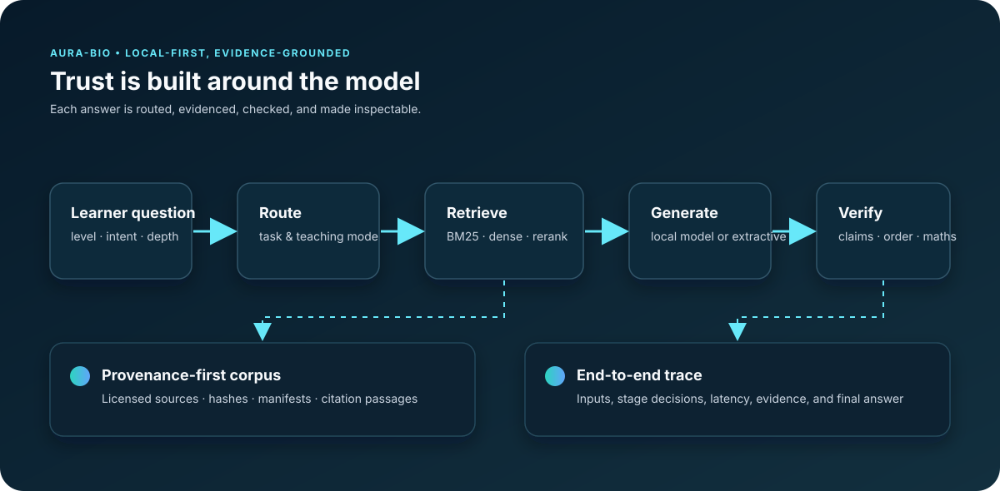

<div align="center">

# 🧬 AURA-Bio

### A local-first, evidence-grounded biology tutoring system

[](https://www.python.org/)
[](https://nodejs.org/)
[](https://fastapi.tiangolo.com/)
[](https://react.dev/)

Answers pass through routing, retrieved evidence, explicit verification checks,
and end-to-end traces. Check results and degraded/interpretive status remain
visible; model descriptions are not independent proof. AURA-Bio earns trust
from the system around a small local model—not from model scale alone.

[Quick start](#quick-start) · [Study material](docs/study-packs.md) · [Measured results](#measured-results) · [Architecture](#system-architecture) · [Components](#components) · [Docs hub](docs/README.md) · [Troubleshooting](#troubleshooting)



</div>

> **New here?** Run `python scripts/launcher.py` for a guided readiness check,
> dependency setup, and local launch. The detailed manual path remains below
> for reproducible development and headless machines.

Full specification: [`srs.md`](srs.md). Start from the [documentation hub](docs/README.md) to find the runtime, pipeline, frontend, evaluation, and project-status guides.

**Local study packs:** upload PDF, PPTX, XLSX, PNG/JPEG or UTF-8 text/Markdown, inspect
page/slide/cell-aware extraction, and ask through a pack-only pipeline with
source previews. Uploaded material stays separate from the original corpus.
See [setup, privacy, limits and the frozen grounding evaluation](docs/study-packs.md).
Explicit, checkpointed OCR/figure-description passes, manual crops and source
annotations are now available. OCR/vision stays opt-in, with provenance carried
through retrieval and citations; interpretations never verify themselves.
See [visual setup and limits](docs/study-packs.md#visual-passes-2026-10-07).
Ask supports question-focused figure/page references, source-backed procedures,
comparisons, arithmetic and excerpt study guides, with optional local thinking.
See [document question flow and limits](docs/document-question-flow.md).
Tests are not an accuracy guarantee.

## Quick start

```powershell
# From the repository root. The launcher never uploads data or starts installs
# until you select an action in its window.
python scripts/launcher.py
```

It discovers this checkout, checks Python, Node, the installed local packages,
Ollama, and the retrieval index, then can install the two local dependency sets
or launch the API and frontend. It works with the current `aura_bio_system/`,
`corpus_pipeline/`, `aura_corpus/`, and `frontend/` layout; it does **not** rely
on the alternative `apps/` and `packages/` layout used by the companion repository.

For a non-GUI readiness report:

```powershell
python scripts/launcher.py --headless-check
```

## Components

| Package | CLI | Role |
|---|---|---|
| [`aura_corpus/`](aura_corpus) | `aura-corpus` | provenance-first corpus **acquisition** |
| [`corpus_pipeline/`](corpus_pipeline) | `aura-process` | cleaning, chunking, embedding, **index building** |
| [`aura_bio_system/`](aura_bio_system) | `aura-bio`, `aura-bio-api` | per-query **runtime**: routing, retrieval, verification, critique, tracing |
| [`frontend/`](frontend) | `npm run dev` | Vite + React **interface**: ask, retrieval lab, evaluation, traces |

## System architecture

A learner question is classified for intent, level, teaching mode, and depth;
the retrieval layer then gathers and reranks licensed evidence before the local
generator drafts a response. Deterministic and evidence-based checks can request
repairs before the answer, citations, and a stage-by-stage trace reach the UI.

The layers degrade independently: sparse BM25 retrieval works without the dense
index, and evidence-based extractive answers remain available when Ollama is not
running. See the [runtime guide](aura_bio_system/README.md) for implementation
details and the [SRS](srs.md) for the safety and pedagogical constraints.

## Measured results

The raw Qwen 3.5 4B model already answers much of the project's textbook-style
biology benchmark. On a corrected, paired 50-question subset, the full pipeline
scored higher, but the sample does not establish an accuracy improvement:

| Configuration | Overall score | Concept recall |
|---|---:|---:|
| Raw model | 0.8757 | 0.8857 |
| Full pipeline | 0.9030 | 0.9130 |

The overall difference was +0.0273, with a reported 95% confidence interval of
−0.021 to +0.076. Earlier comparisons also used different generation settings
for the two configurations, so a matched rerun is needed before making a causal
claim about retrieval. The original 0.375 adversarial "hallucination rate" was
partly a literal-phrase scoring error: manual review found one fabricated answer
out of eight for each configuration. These results are documented, including
the failed hypotheses and scoring corrections, in
[`FINDINGS.md`](aura_bio_system/benchmarks/FINDINGS.md).

What the pipeline presently adds is inspectable source provenance, deterministic
checks for biology calculations and terminology, evidence contradiction checks,
and traceable decisions. The current implementation uses a biology-specific
router, prompts, and verifier. Study packs provide a general text/arithmetic
scope plus explicit visual intake; general-purpose domain plug-ins, ephemeral
ask-with-image and visual answer generation remain separate proposed extensions.
No fine-tuned model has been produced for this project.

---

## Running the complete system

This is the full path from a clean checkout to a working browser interface
backed by the real pipeline. If you only want the corpus tooling, skip to
[Corpus acquisition](#corpus-acquisition).

### 0. Prerequisites

| Requirement | Notes |
|---|---|
| Python 3.11+ | 3.13 is what the project is developed against |
| Node 22.13+ | for the frontend (the declared project engine) |
| [Ollama](https://ollama.com) | serves the local model; optional, the API degrades to extractive answers without it |
| ~8 GB free RAM | dense retrieval holds a ~1 GiB index plus encoders |
| A built index | see [Building the index](#building-the-index) if you do not have one |

**Disk layout matters.** Model caches and indexes are large. The system drive
filling up is the single most common cause of confusing failures here: it
surfaces as Ollama HTTP 500s, joblib `OSError 1455`, and worker crashes that
look unrelated. Keep `HF_HOME` on a drive with room.

### 1. Install the Python packages

From the repository root:

```powershell
python -m pip install -e .                          # aura_corpus (acquisition)
python -m pip install -e .\corpus_pipeline          # aura_bio_pipeline (indexing + retrieval)
python -m pip install -e ".\aura_bio_system[api]"   # runtime + FastAPI/uvicorn
```

Installing `aura_bio_system` without `[api]` is fine if you only need the CLI
and benchmarks.

### 2. Configure the environment

Copy `.env.example` to `.env` at the repository root and fill it in:

```ini
AURA_CORPUS_ROOT=D:\aura_data\AURA-Bio-Corpus
AURA_MAX_TOTAL_BYTES=50GB

# Local generation through Ollama.
OLLAMA_MODEL=qwen3.5:4b
OLLAMA_ENDPOINT=http://127.0.0.1:11434/api/chat

# Optional external critic. The system runs fully without a key.
ZAI_API_KEY=
ZAI_MODEL=glm-4.7-flash
ZAI_ENDPOINT=https://api.z.ai/api/paas/v4/chat/completions

# Keep large model caches off the system drive.
HF_HOME=D:\hf-cache
```

`.env` is gitignored and must stay that way: it holds credentials. Cache-path
variables are applied automatically at import (`aura_bio/__init__.py`), so every
entry point picks up `HF_HOME` before any model download starts.

### 3. Prepare the local model

The runtime prefers a persona build named `aura-bio:v0`. Create it from any
Qwen 3.5 4B base:

```powershell
ollama pull qwen3.5:4b
ollama create aura-bio:v0 -f Modelfile     # if you have a Modelfile
# or point the runtime at the base model instead:
#   set AURA_OLLAMA_MODEL=qwen3.5:4b
```

Verify it responds:

```powershell
ollama run aura-bio:v0 "Name one organelle."
```

Without Ollama the API still starts and answers **extractively** from retrieved
evidence, which is enough to exercise routing, retrieval, and verification.

### 4. Build the index

If you already have `AURA-Bio-Index` on disk, skip this. Otherwise see
[`corpus_pipeline/README.md`](corpus_pipeline/README.md) for the full
acquisition-to-index path. The runtime needs, at minimum:

```text
<index-root>/
  retrieval.manifest.json
  core-sparse.sqlite3          # BM25 / FTS5 channel  (required)
  core-dense.faiss             # dense channel        (optional)
  core-dense-map.sqlite3       # dense id mapping     (optional)
  core-dense.manifest.json
```

The sparse channel alone is enough to run. Dense adds semantic retrieval at the
cost of roughly 1 GiB of RAM.

### 5. Train the query router (optional but recommended)

The runtime loads a trained classifier from
`aura_bio_system/benchmarks/router_model/` when present, and falls back to
hand-written rules when it is not.
 
```powershell
python aura_bio_system\benchmarks\run_routing_eval.py --all --encoders sapbert,bge --ablate --jobs 1 --save
```
 
This writes `router.manifest.json` plus one `.joblib` per routed dimension. Set
`AURA_ROUTER=rules` to force the rules-only path (useful for ablation parity).

### 6. Start the backend

```powershell
$env:AURA_DENSE = "1"      # enable the dense retrieval channel
$env:AURA_RERANK = "1"     # enable the cross-encoder reranker
aura-bio-api --index-root G:\aura_data\AURA-Bio-Index
```

The server listens on `http://127.0.0.1:8000`. Confirm it is healthy:

```powershell
curl http://127.0.0.1:8000/api/v1/health
```

`status` will be `ready` when both channels are up, `partial` with only one, and
`offline` with no index at all.

### 7. Point the frontend at the backend

The frontend talks to the real backend only; there is no mock or demo mode.
Every page reads from the API, so the backend must be running first.

```powershell
cd frontend
npm install
npm run dev
```

Open `http://127.0.0.1:5173`. The default API base is
`http://127.0.0.1:8000`; override it by creating `frontend/.env.local`:

```ini
VITE_API_BASE_URL=http://127.0.0.1:8000
```

A real answer takes tens of seconds, because it is genuinely routing,
retrieving, generating, and verifying. Panels that have no data yet say so
rather than showing sample content.

### 8. Verify the whole path

Ask a question in the UI and check that:

- the backend logs `POST /api/v1/runs` followed by `GET /api/v1/runs/<id>/events`;
- the answer carries inline `[1]`, `[2]` citations;
- the evidence drawer lists real passages with source titles and licences;
- `/traces/<run-id>` shows every stage with real timings.

A scripted end-to-end check over a few benchmark questions:

```powershell
python aura_bio_system\benchmarks\run_full_rag.py --system full_rag --dense --rerank --critic --limit 6 --tag smoke
python aura_bio_system\benchmarks\check_liveness.py aura_bio_system\benchmarks\results\smoke.jsonl
```

`check_liveness.py` reports which pipeline stages actually fired. It exists
because a component can load, report healthy, and never be consulted, which no
unit test and no accuracy score will catch.

### Environment variables

| Variable | Default | Effect |
|---|---|---|
| `AURA_INDEX_ROOT` | `G:\aura_data\AURA-Bio-Index` | where the retrieval indexes live |
| `AURA_DENSE` | `0` | `1` enables the dense (FAISS) channel |
| `AURA_RERANK` | `0` | `1` enables the cross-encoder reranker |
| `AURA_ROUTER` | learned | `rules` forces the rules-only router |
| `AURA_GENERATOR` | ollama | `extractive` forces the no-model path |
| `AURA_OLLAMA_MODEL` | `aura-bio:v0` | override the local model tag |
| `AURA_OLLAMA_HOST` | `http://127.0.0.1:11434` | override the Ollama endpoint |
| `AURA_CRITIC` | `glm` | `gemini`, or `off` to disable the external critic |
| `AURA_TRACE_DB` | `<index-root>/traces.sqlite3` | trace store location |
| `AURA_NLI` | on | `off` disables contradiction detection (fastest single saving) |
| `HF_HOME` | from `.env` | Hugging Face cache location |

### Troubleshooting

| Symptom | Cause |
|---|---|
| Frontend panels are empty | Expected on a fresh backend: they show real runs, and there are none yet. Ask a question. |
| **Browser reports a CORS error on `POST /api/v1/runs`, but `/health` works** | Almost never actually CORS. An unhandled exception is returned by Starlette's outermost error middleware, which sits *outside* the CORS middleware, so the 500 carries no `Access-Control-Allow-Origin` header and the browser blames CORS. Reproduce with `curl` (no CORS involved) and read the backend traceback. |
| `OSError: The paging file is too small` (os error 1455) | Out of memory, **not** necessarily out of disk. The router's SapBERT+BGE encoders load lazily on the *first query*, on top of the dense index, reranker, NLI model and Ollama. See [Reducing memory use](#reducing-memory-use). |
| Ollama returns HTTP 500 for every request | Check **system drive free space** first: with the disk full Windows cannot grow its paging file, and this surfaces as unrelated-looking failures across several components at once. |
| `retrieval index not available` (503) | `retrieval.manifest.json` missing or `--index-root` wrong |
| Backend starts but answers extractively | Ollama unreachable, or `AURA_GENERATOR=extractive` is set |
| `404` on `/api/v1/runs/run-demo-...` | The sidebar's "Pipeline traces" link is hardcoded to a sample run id that only exists in mock mode. Cosmetic; the page shows an "unavailable" banner. |

### Where the time goes

A single answer runs several models, so it takes tens of seconds to a couple
of minutes. Measured end to end on one real request:

| Stage | Time | Share |
|---|---:|---:|
| routing | 0.2 s | — |
| retrieval | 2.6 s | 1% |
| rerank | 10.4 s | 3% |
| generation | 56.5 s | 17% |
| verification | 39 s | 12% |

Verification originally dominated this at **259 s (79%)**, far more than
generation. The natural-language-inference checker was being called once per
(passage, claim) pair, so its batch size never engaged: 18 claims against 4
passages each meant 72 single-item forward passes. Batching them by round
made it about 7x faster with byte-identical labels.

If a request is still slower than you want, in rough order of value lost:

```powershell
$env:AURA_NLI = "off"       # skips contradiction detection entirely
$env:AURA_RERANK = "0"      # skips cross-encoder reranking (~10 s)
```

Generation itself is bounded by the local model's token rate, so the honest
floor is roughly a minute for a full-length answer on this hardware.

### Reducing memory use

Everything on at once (dense index, reranker, learned router, NLI verifier, plus
Ollama holding the model) wants roughly 6-8 GB of RAM beyond the OS. On a 16 GB
machine with a browser and an IDE open, that is tight, and the first symptom is
a model failing to load *during the first query* rather than at startup.

Turn components off in this order, cheapest capability loss first:

```powershell
$env:AURA_RERANK = "0"      # drops the cross-encoder (~400 MB)
$env:AURA_ROUTER = "rules"  # drops the SapBERT+BGE router encoders (~800 MB)
$env:AURA_DENSE  = "0"      # drops the FAISS dense index (~1 GiB), BM25 still works
```

Each is independently switchable precisely so the system stays usable on a
smaller machine.

---

## Tests

```powershell
python -m pytest aura_bio_system\tests -q      # runtime: routing, verification, API
python -m pytest corpus_pipeline\tests -q      # indexing and retrieval
python -m unittest discover -s tests -v        # acquisition
cd frontend; npm test                          # frontend
```

The Python suites run without a GPU, without a model download, and without the
built indexes.

---

## Documentation

| Document | Contents |
|---|---|
| [`srs.md`](srs.md) | full specification (37 sections) |
| [`aura_bio_system/README.md`](aura_bio_system/README.md) | runtime design, API contract, verification layer |
| [`corpus_pipeline/README.md`](corpus_pipeline/README.md) | preparation and index building |
| [`frontend/README.md`](frontend/README.md) | interface routes and contracts |
| [`aura_bio_system/benchmarks/FINDINGS.md`](aura_bio_system/benchmarks/FINDINGS.md) | what measuring the pipeline actually showed |

---

## Corpus acquisition

This section covers the provenance-first acquisition pipeline. It uses official
dumps, FTP-over-HTTPS endpoints, and machine-readable catalogues instead of
scraping rendered web pages.

The pipeline is intentionally conservative:

- large downloads are never started by the default command;
- bulk sources require both `--yes` and `--allow-bulk`;
- interrupted downloads resume from `.part` files when the server supports ranges;
- a shared 50 GB hard cap prevents concurrent workers from silently exceeding the corpus ceiling;
- official MD5/SHA1 values are checked when the provider publishes them;
- gzip, bzip2, zip, and tar integrity is verified;
- unsafe or invalid downloads are moved to `90_Quarantine`;
- every file and decision is recorded in SQLite and exported as JSONL;
- external GLM review is optional and never receives files automatically.

### Included official sources

- PubMed 2026 annual baseline XML
- PMC Open Access commercial-use XML through licence-filtered ESearch and 100-article EFetch batches
- English Wikipedia biology-category revision batches and the Wikibooks dump
- NLM LitArch Open Access biology book packages
- reviewed UniProtKB/Swiss-Prot
- Gene Ontology
- Reactome pathway summaries
- 2026 MeSH descriptors
- PubMedQA expert-labeled QA and held-out ground truth
- Biology LibreTexts, E-Books Directory, and FreeBookCentre biology catalogs as licence-review queues

Source URLs, licence references, and selection policy are in
[`config/sources.toml`](config/sources.toml). OpenStax is deliberately absent
because its current Biology 2e page places an additional restriction on
generative-AI ingestion.

BioASQ is recorded as a potential later manual import, not an automated source,
because its training downloads currently require participant registration.
PubMedQA test ground truth is stored under `04_QA` but must remain
evaluation-only.

### Quick start

Python 3.11 or newer is sufficient; the acquisition path has no third-party
dependencies.

Run the complete bounded pilot (catalog discovery, small datasets, two PubMed
files, 25 PMC articles, five NLM books, verification):

```powershell
powershell -ExecutionPolicy Bypass -File .\scripts\run_pipeline.ps1 -Profile pilot
```

To create only the textbook review queues:

```powershell
powershell -ExecutionPolicy Bypass -File .\scripts\run_pipeline.ps1 -Profile catalog
```

```powershell
python -m aura_corpus sources
python -m aura_corpus plan --source gene_ontology --source reactome_summaries
python -m aura_corpus fetch --source gene_ontology --source reactome_summaries --yes
python -m aura_corpus verify
python -m aura_corpus status
```

The three directory sources are intentionally handled by `catalog`, not `fetch`:

```powershell
python -m aura_corpus catalog
```

This writes JSONL candidates under `05_Metadata/catalog_candidates/`.
BioLibreTexts carries open content with per-page conditions, while the other two
sites point to third-party material. A candidate remains
`license_state: unknown` until its actual author/publisher licence is reviewed;
the pipeline will not automatically download it.

For this research-only, non-commercial corpus, audit candidates and download
only explicitly supported items:

```powershell
python -m aura_corpus audit-books
python -m aura_corpus fetch-books --yes
```

The allowlist is CC0, CC BY, CC BY-SA, CC BY-NC, and CC BY-NC-SA. Mixed,
undeclared, CK-12, ND, all-rights-reserved, and directory-only claims are
rejected. Every accepted PDF retains its item page, licence-evidence URL, use
scope, and checksum.

The `plan` command accesses only provider indexes/catalogues and writes:

```text
AURA-Bio-Corpus/05_Metadata/corpus.sqlite3
AURA-Bio-Corpus/05_Metadata/manifests/files.jsonl
```

Downloaded files are stored under `<category>/raw/<source-id>/`. PMC EFetch
batches are already XML. Compressed LitArch, UniProt, MeSH and Wikibooks files
can be safely normalized with:

```powershell
python -m aura_corpus extract
```

For a large manifest, normalize one source at a time. Archive extraction is
resumable through per-archive completion markers:

```powershell
python -m aura_corpus extract --source uniprot_sprot
python -m aura_corpus extract --source nlm_litarch_biology
```

To stay within the corpus ceiling while normalizing a large archive collection,
replace each verified archive with its expanded output:

```powershell
python -m aura_corpus extract --source nlm_litarch_biology --delete-raw
```

For 10,000 commercially reusable PMC articles, discovery creates 100 XML batches
rather than making per-article S3 metadata calls:

```powershell
python -m aura_corpus fetch --source pmc_oa_comm_xml --max-files 10000 --allow-bulk --yes --workers 3
```

Repeating that exact command intentionally returns the same first 10,000
results. Use non-overlapping PMC release-date windows to continue, or let the
CLI split an entire year into seven-day windows:

```powershell
python -m aura_corpus fetch --source pmc_oa_comm_xml --pmc-window 2025-01-01:2025-01-07 --max-files 10000 --allow-bulk --yes --workers 3
python -m aura_corpus fetch --source pmc_oa_comm_xml --pmc-year 2024 --max-files 10000 --allow-bulk --yes --workers 3 --max-source-bytes 8GB
```

### Pilot and bulk downloads

Always plan first. A two-file PubMed pipeline test is:

```powershell
python -m aura_corpus plan --source pubmed_baseline --max-files 2
python -m aura_corpus fetch --source pubmed_baseline --max-files 2 --allow-bulk --yes
```

The full PubMed baseline is intentionally explicit:

```powershell
python -m aura_corpus plan --source pubmed_baseline
python -m aura_corpus fetch --source pubmed_baseline --allow-bulk --yes --workers 3
```

Optional per-file protection accepts decimal or binary units:

```powershell
python -m aura_corpus fetch --source wikibooks_en --allow-bulk --yes --max-file-bytes 1GiB
```

The default total corpus cap is 50 decimal GB. It can be lowered explicitly with
`--max-total-bytes`; increasing it should be a deliberate storage decision.

Wikipedia is deliberately collected through `Category:Biology`, not the full
English dump:

```powershell
python -m aura_corpus plan --source wikipedia_biology
python -m aura_corpus fetch --source wikipedia_biology --allow-bulk --yes --max-source-bytes 7GB
```

The configured traversal is bounded to 250,000 main-namespace articles, six
category levels, and 50 pages per revision-JSON batch, targeting roughly 6-7 GB
while the byte cap remains authoritative. Category graphs and article sizes
change, so monitor actual size and relevance during acquisition.

Discovery is checkpointed locally. Collect incrementally by increasing
`--max-files`; 1,000 batches means up to 50,000 pages. Later runs resume
category traversal and skip batches already downloaded:

```powershell
python -m aura_corpus fetch --source wikipedia_biology --max-files 1000 --allow-bulk --yes --workers 1 --max-source-bytes 8GB
python -m aura_corpus fetch --source wikipedia_biology --max-files 2000 --allow-bulk --yes --workers 1 --max-source-bytes 8GB
```

### Compact the PubMed baseline

The annual baseline is citation-heavy and can occupy roughly 45 GB compressed.
Convert it into training-oriented English records with abstracts, MeSH headings,
identifiers, provenance, and retraction/type gates:

```powershell
python -m aura_corpus filter-pubmed --max-files 2
python -m aura_corpus filter-pubmed
```

After inspecting the filtered shards and manifest, reclaim raw storage safely:

```powershell
python -m aura_corpus filter-pubmed --delete-raw
```

Raw files are deleted individually only after their corresponding `.jsonl.gz`
output passes a full gzip verification. Existing output shards are skipped, so
the operation is resumable.

Do not run all bulk sources merely to reach a byte target. Build and evaluate a
controlled retrieval pilot first.

### Qwen and optional GLM curation

The curator accepts JSONL records containing source metadata and a short `text`
or `excerpt`. A record should include a deterministic licence decision:

```json
{"source_id":"pmc_oa_comm_xml","title":"Example","license_state":"allowed","license_id":"CC BY","retracted":false,"text":"A sufficiently long excerpt..."}
```

Local Qwen only:

```powershell
python -m aura_corpus curate --input candidates.jsonl --output decisions.jsonl
```

Local Qwen with GLM-4.5-Flash fallback:

```powershell
python -m aura_corpus curate --input candidates.jsonl --output decisions.jsonl --use-glm
```

Rules run before either model. Documents with unknown licences or retraction
flags are quarantined deterministically. Qwen is the primary classifier. GLM is
called only when Qwen's confidence is below the configured threshold.
Disagreement always produces quarantine. API keys are read from the environment
and are never written to the corpus manifest.

Only send externally licensed, non-private snippets to GLM. The program
truncates excerpts to 6,000 characters, but legal permission still needs to be
established before invoking the external API.
